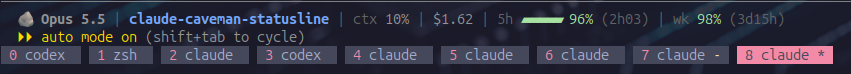

# 🪨 claude-caveman-statusline

A compact, Codex-style status line for [Claude Code](https://docs.claude.com/en/docs/claude-code) that shows the [caveman](https://github.com/JuliusBrussee/caveman) mode badge, the current model, project and git worktree, context usage, session cost in USD, **how much of your 5-hour and weekly usage is left** (with reset countdowns), and a clickable link to Claude's working files.



It's one small Bash script and needs no background process, API calls, or token handling.

## Features

```
🪨 Opus 5.5 | proj/src | wt feature-xyz | 📂 2 | ctx 34% | $1.23 | 5h ▰▰▰▱▱ 60% (2h10) | wk 28% (3d04h)
```

The left part shows where you work and the right part shows what you use.

**Where you work**

- **Caveman badge**: 🪨 when caveman mode is on, 🪨LITE / 🪨ULTRA for other levels. Hidden when caveman is not installed.
- **Model**: the active model, in bold.
- **Project**: the folder where Claude Code was launched. When the working directory moves elsewhere, the subfolder is added, as in `proj/src`.
- **Git worktree**: `wt name`, shown only in a linked git worktree or a Claude Code worktree session.
- **Scratchpad**: `📂 N` is the number of files in the session's scratchpad, the folder where Claude keeps its working files. Shown only when the folder holds files. Ctrl+click (Cmd+click on macOS) opens it.

**What you use**

- **Context**: `ctx N%`, the percentage of the context window used.
- **Session cost**: `$N.NN`, the cost of the current session in USD, as Claude Code reports it.
- **5-hour limit**: a progress bar of the *remaining* usage, then the time until the window resets, such as `(2h10)`.
- **Weekly limit**: `wk N%`, the remaining weekly usage, then the time until it resets, such as `(3d04h)`.
- **Colors**: the remaining usage is green above 50%, yellow above 20%, and red below that.

**Behavior**

- **One row**: everything fits on one row. If the row is wider than the terminal, it splits into two rows between the two parts, so nothing is cut off.
- **No overlapping characters**: separators and labels are plain ASCII, so the line renders correctly in tmux and other terminals.
- **Graceful fallback**: any field that Claude Code doesn't send is hidden instead of causing an error.

## Requirements

| Requirement | Notes |
|---|---|
| Linux (or macOS with GNU `date`) | Bash 4+ |
| [`jq`](https://jqlang.github.io/jq/) | `sudo apt install jq` / `sudo dnf install jq` |
| Claude Code **2.1.80+** | Needed for the `rate_limits` data |
| Claude **Pro / Max** login | Usage bars only appear for subscribers, after the first message in a session |
| [caveman](https://github.com/JuliusBrussee/caveman) plugin | *Optional*, only needed for the 🪨 badge |

## Installation

### 1. Get the script

```bash
curl -fsSL https://raw.githubusercontent.com/MBaranekTech/claude-caveman-statusline/main/statusline.sh \
  -o ~/.claude/statusline.sh
chmod +x ~/.claude/statusline.sh
```

### 2. Register it in `~/.claude/settings.json`

Open the config file:

```bash
nano ~/.claude/settings.json
```

**If the file is empty or doesn't exist**, paste this:

```json
{
  "statusLine": {
    "type": "command",
    "command": "~/.claude/statusline.sh",
    "padding": 0
  }
}
```

**If you already have settings**, add `statusLine` as a **top-level key**, at the same indentation as keys like `"model"`, `"theme"` or `"tui"`. Don't put it inside another block such as `enabledPlugins` or `autoMode`. For example, put it right after `"theme"`:

```jsonc
{
  "model": "opus",
  "enabledPlugins": { ... },
  "tui": "fullscreen",
  "theme": "dark",
  "statusLine": {                          // 👈 add this block
    "type": "command",
    "command": "~/.claude/statusline.sh",
    "padding": 0
  },                                       // 👈 comma, because another key follows
  "autoMode": { ... }
}
```

> ⚠️ Mind the commas: every key except the last one needs a `,` after it. If you add `statusLine` as the **last** key, remove its trailing comma and make sure the key before it ends with `,`.

In nano, save with **Ctrl+O**, press **Enter**, and exit with **Ctrl+X**.

Validate the file:

```bash
jq . ~/.claude/settings.json > /dev/null && echo OK
```

### 3. (Optional) Install caveman

```bash
claude plugin marketplace add JuliusBrussee/caveman
claude plugin install caveman@caveman
```

### 4. Restart Claude Code

The status line appears at the bottom of the screen.

## Test without Claude Code

```bash
echo '{"model":{"display_name":"Opus"},"workspace":{"current_dir":"/home/me/proj","project_dir":"/home/me/proj","git_worktree":"feature-xyz"},"context_window":{"used_percentage":34},"cost":{"total_cost_usd":1.2345},"rate_limits":{"five_hour":{"used_percentage":40,"resets_at":'$(( $(date +%s)+7800 ))'},"seven_day":{"used_percentage":72,"resets_at":'$(( $(date +%s)+273600 ))'}}}' \
  | ~/.claude/statusline.sh
```

Expected output:

```
🪨 Opus | proj | wt feature-xyz | ctx 34% | $1.23 | 5h ▰▰▰▱▱ 60% (2h10) | wk 28% (3d04h)
```

## How it works

On every refresh, Claude Code pipes a JSON object with session data to the script on stdin, and the script prints one line. If that line is wider than `$COLUMNS` (which Claude Code sets to the terminal width), the script prints two lines instead, and Claude Code shows each as a separate row. The status line reads these fields:

| Field | Shown as |
|---|---|
| `model.display_name` | Model name |
| `workspace.project_dir` | Project name |
| `workspace.current_dir` | `/sub`, only when it differs from the project |
| `worktree.name` / `workspace.git_worktree` | `wt name` |
| `context_window.used_percentage` | `ctx N%` |
| `cost.total_cost_usd` | `$N.NN` |
| `rate_limits.five_hour.used_percentage` / `resets_at` | `5h` bar and reset countdown |
| `rate_limits.seven_day.used_percentage` / `resets_at` | `wk N%` and reset countdown |
| `session_id` | Locates the scratchpad folder for `📂 N` |

The session cost is Claude Code's own estimate for the current session, at API prices. On a Pro/Max plan it shows what the session would cost at API rates, not what you are billed.

The scratchpad is the session's temporary folder, `/tmp/claude-<uid>/<project>/<session_id>/scratchpad`. The script finds it by `session_id`, also under `$CLAUDE_CODE_TMPDIR` and `$TMPDIR`, and counts its files. The link is an [OSC 8](https://en.wikipedia.org/wiki/ANSI_escape_code#OSC) `file://` URL. In terminals without hyperlink support, only the text `📂 N` is shown.

The caveman plugin's SessionStart hook writes the current mode to `~/.claude/.caveman-active` (or `$CLAUDE_CONFIG_DIR/.caveman-active`), and the script reads that file to show the badge.

## Customization

Edit `~/.claude/statusline.sh`. Changes apply on the next refresh, without a restart.

**Where you work**

| Want to… | Do this |
|---|---|
| Hide the caveman badge | Change `"${cave}\e[1m${model}\e[0m"` to `"\e[1m${model}\e[0m"` in the `l1=` line |
| Hide the project name | Remove `"${where}"` from the `l1=` line |
| Hide the git worktree | Delete the `[ -n "$wt" ]` line |
| Hide the scratchpad link | Delete the `[ -n "$scratch" ]` line |

**What you use**

| Want to… | Do this |
|---|---|
| Hide context % | Delete the `[ -n "$ctx" ]` line |
| Hide session cost | Delete the `[ -n "$cost" ]` line |
| Hide the 5-hour limit | Delete the `[ -n "$h5" ]` line |
| Hide the weekly limit | Delete the `if [ -n "$d7" ]` block, up to its `fi` |
| Hide reset countdowns | Delete `$(until_reset "$r5")` and `$(until_reset "$r7")` |
| Wider bar | Change `w=5` in `bar()` |
| Different bar style | Replace `▰` / `▱` with `█` / `░` or `●` / `○` |
| Change color thresholds | Edit `50` and `20` in `col()` |

**Layout**

| Want to… | Do this |
|---|---|
| Always two rows | Replace the `if [ -n "$COLUMNS" ] ...` line with `if true; then` |
| Different separator | Change `\|` in `sep=" \e[2m\|\e[0m "`, for example to `-` or `/` |
| Move an item | Move its `l1+=` / `l2+=` line. The order of the lines is the order on the bar |
| No emoji | Replace `🪨` with `CM` and `📂` with `tmp` |

> 💡 Prefer ASCII or common emoji for separators and labels. Box-drawing and symbol glyphs such as `│`, `⎇` or `↻` can overlap their neighbours in tmux. If you add a new emoji, also add it to `[^🪨📂]` in `width()`, so the row still splits at the right width.

## Troubleshooting

**No usage bars.** You may be logged in with an API key instead of a Pro/Max account (check with `claude auth status`), or no message has been sent yet in the session. Update Claude Code with `claude update`.

**No 🪨 badge.** Start a new session so the caveman hook writes its flag file, then check it with `cat ~/.claude/.caveman-active`. Inside Claude Code, run `/hooks` to confirm that caveman's SessionStart hook is registered.

**Characters overlap.** Box-drawing and symbol glyphs such as `│`, `⎇` or `↻` have ambiguous widths, and tmux, the terminal and the font can disagree on them. The script uses plain ASCII separators for this reason. If you add your own symbols, prefer ASCII or common emoji.

**Scratchpad link isn't clickable in tmux.** tmux 3.4+ forwards OSC 8 links only when the outer terminal has the `hyperlinks` feature. Add `set -as terminal-features ',*:hyperlinks'` to `~/.tmux.conf`, then run `tmux source-file ~/.tmux.conf` (or restart tmux).

**Status line doesn't appear.** Make sure `settings.json` is valid JSON and the script is executable (`chmod +x`). Pipe the test JSON above into the script to see any errors.

**Caveman replaced my status line.** On first run, the caveman plugin may offer to set up its own status line. Decline, or point `statusLine.command` back to this script.

## How it was made

I built this in a conversation with Claude. I started from the idea of a Codex-like status bar in Claude Code with the caveman badge and remaining-usage progress bars. Then I iterated on it in my real terminal, fixing a doubled `CAVEMAN:CAVEMAN` badge and making the layout less crowded, until it looked right.

In a second round, I worked with Claude Code itself, which uses this status line. I asked for the project name, the git worktree, reset times for both limits, and a link to Claude's working files. The first version was too crowded. In tmux, symbols such as `│`, `⎇` and `↻` also overlapped their neighbours, because tmux, the terminal and the font disagreed on their width. We replaced them with plain ASCII. Then we put everything back on one row that splits into two only when the terminal is too narrow.

## Credits

- [caveman](https://github.com/JuliusBrussee/caveman) by Julius Brussee, for the 🪨 mode and its flag file
- [Claude Code](https://docs.claude.com/en/docs/claude-code) status line API by Anthropic

This project is not affiliated with Anthropic or the caveman project.

## License

[MIT](LICENSE)

---

<details>
<summary>📄 Full script (<code>statusline.sh</code>)</summary>

```bash
#!/usr/bin/env bash
# claude-caveman-statusline
# Compact Claude Code status line: caveman badge, model, project, git worktree,
# context usage, session cost, remaining 5-hour / weekly usage with reset
# countdowns, and a clickable link to the session's scratchpad folder.
# Requires: jq, Claude Code >= 2.1.80 (usage bars need Pro/Max login)

input=$(cat)
j() { echo "$input" | jq -r "$1 // empty"; }

model=$(j '.model.display_name')
cur=$(j '.workspace.current_dir')
proj=$(j '.workspace.project_dir')
wt=$(j '.worktree.name // .workspace.git_worktree')
sid=$(j '.session_id')
ctx=$(j '.context_window.used_percentage')
cost=$(j '.cost.total_cost_usd')
h5=$(j '.rate_limits.five_hour.used_percentage')
d7=$(j '.rate_limits.seven_day.used_percentage')
r5=$(j '.rate_limits.five_hour.resets_at')
r7=$(j '.rate_limits.seven_day.resets_at')

# Color by remaining %: green > 50, yellow > 20, red otherwise
col() { local l=$1; ((l > 50)) && echo 32 || { ((l > 20)) && echo 33 || echo 31; }; }

# Thin 5-segment bar of REMAINING usage
bar() {
  local left=$((100 - ${1%.*})) w=5 s="" i; ((left < 0)) && left=0
  local fill=$(( (left * w + 50) / 100 ))
  for ((i=0; i<w; i++)); do ((i < fill)) && s+="▰" || s+="▱"; done
  printf '\e[%sm%s %d%%\e[0m' "$(col $left)" "$s" "$left"
}

# Dim countdown until a limit window resets: " (2h10)" or " (3d04h)"
# Accepts epoch seconds or an ISO timestamp.
until_reset() {
  local r=$1 ts m
  [ -z "$r" ] && return
  [[ $r =~ ^[0-9]+$ ]] && ts=$r || ts=$(date -d "$r" +%s 2>/dev/null)
  [ -z "$ts" ] && return
  m=$(( (ts - $(date +%s)) / 60 )); ((m < 0)) && m=0
  if ((m >= 1440)); then
    printf ' \e[2m(%dd%02dh)\e[0m' $((m / 1440)) $((m % 1440 / 60))
  else
    printf ' \e[2m(%dh%02d)\e[0m' $((m / 60)) $((m % 60))
  fi
}

# Caveman badge (plain for default mode, level shown otherwise)
cave=""
f=${CLAUDE_CONFIG_DIR:-$HOME/.claude}/.caveman-active
if [ -f "$f" ]; then
  mode=$(tr -d '[:space:]' < "$f" | tr '[:upper:]' '[:lower:]')
  case "$mode" in ""|full|caveman|on) tag="🪨" ;; *) tag="🪨${mode^^}" ;; esac
  cave="$tag "
fi

# Project name (launch dir); add the current subfolder when Claude moved away from it
[ -z "$proj" ] && proj=$cur
where="\e[1;34m$(basename "$proj")\e[0m"
[ -n "$cur" ] && [ "$cur" != "$proj" ] && where+="\e[2m/\e[0m$(basename "$cur")"

# Session scratchpad (Claude's working files): shown only when it holds files,
# as an OSC 8 link (Ctrl+click / Cmd+click opens the folder)
scratch=""
if [ -n "$sid" ]; then
  for base in "${CLAUDE_CODE_TMPDIR:-}" "${TMPDIR:-}" /tmp; do
    [ -z "$base" ] && continue
    for d in "${base%/}/claude-$(id -u)"/*/"$sid"/scratchpad; do
      [ -d "$d" ] || continue
      n=$(find "$d" -type f 2>/dev/null | wc -l)
      ((n > 0)) && scratch="\e]8;;file://${d// /%20}\a📂 ${n}\e]8;;\a"
      break 2
    done
  done
fi

# One line: where you work, then what you use. Dim labels and separators.
# Separators and labels are plain ASCII: box-drawing and symbol glyphs have
# ambiguous widths in tmux/VTE and can overlap neighbouring characters.
D='\e[2m' R='\e[0m' sep=" \e[2m|\e[0m "
join() { local o="" x; for x in "$@"; do [ -n "$x" ] && o+="${o:+$sep}$x"; done; printf '%s' "$o"; }

l1=("${cave}\e[1m${model}\e[0m" "${where}")
[ -n "$wt" ]      && l1+=("${D}wt${R} \e[35m${wt}\e[0m")
[ -n "$scratch" ] && l1+=("$scratch")

l2=()
[ -n "$ctx" ]  && l2+=("${D}ctx${R} ${ctx%.*}%")
# Session cost in USD (LC_NUMERIC=C so locales with a decimal comma still parse "0.42")
[ -n "$cost" ] && l2+=("\$$(LC_NUMERIC=C printf '%.2f' "$cost")")
[ -n "$h5" ]   && l2+=("${D}5h${R} $(bar "$h5")$(until_reset "$r5")")
if [ -n "$d7" ]; then
  wl=$((100 - ${d7%.*})); ((wl < 0)) && wl=0
  l2+=("${D}wk${R} \e[$(col $wl)m${wl}%\e[0m$(until_reset "$r7")")
fi

# Visible width: drop ANSI colors and OSC 8 links, count each emoji as 2 columns
width() {
  local t; t=$(printf '%b' "$1" | sed -E $'s/\e\\[[0-9;]*m//g; s/\e]8;;[^\a]*\a//g')
  local e=${t//[^🪨📂]/}
  echo $(( ${#t} + ${#e} ))
}

line=$(join "${l1[@]}" "${l2[@]}")
# Too wide for the terminal (Claude Code sets COLUMNS)? Split into two rows.
if [ -n "$COLUMNS" ] && ((COLUMNS > 0)) && (($(width "$line") > COLUMNS)); then
  printf '%b\n' "$(join "${l1[@]}")"
  ((${#l2[@]})) && printf '%b\n' "$(join "${l2[@]}")"
else
  printf '%b\n' "$line"
fi
```

</details>
